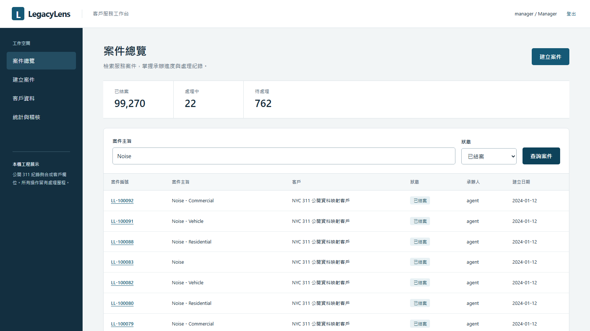
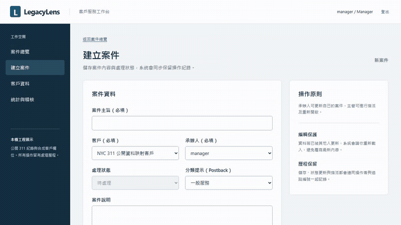
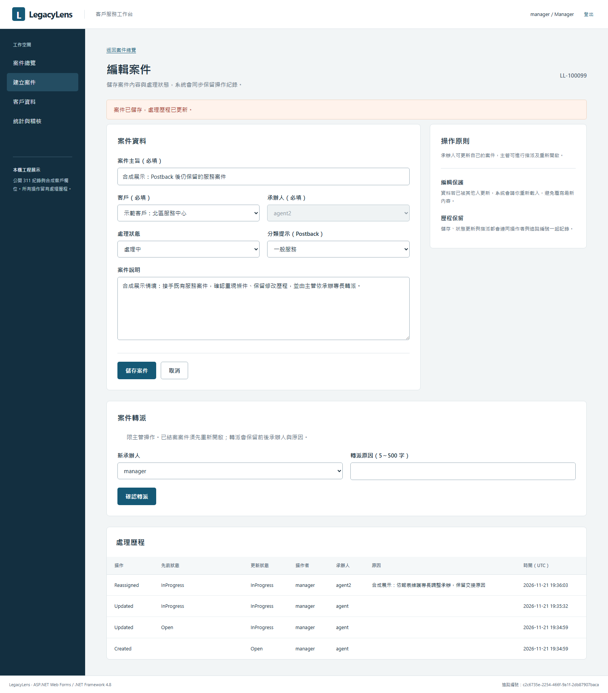
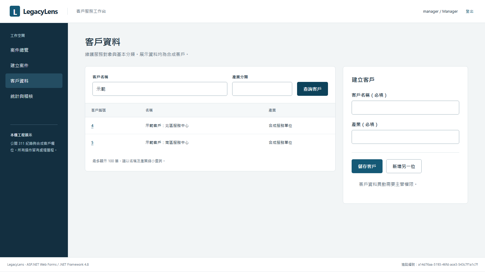
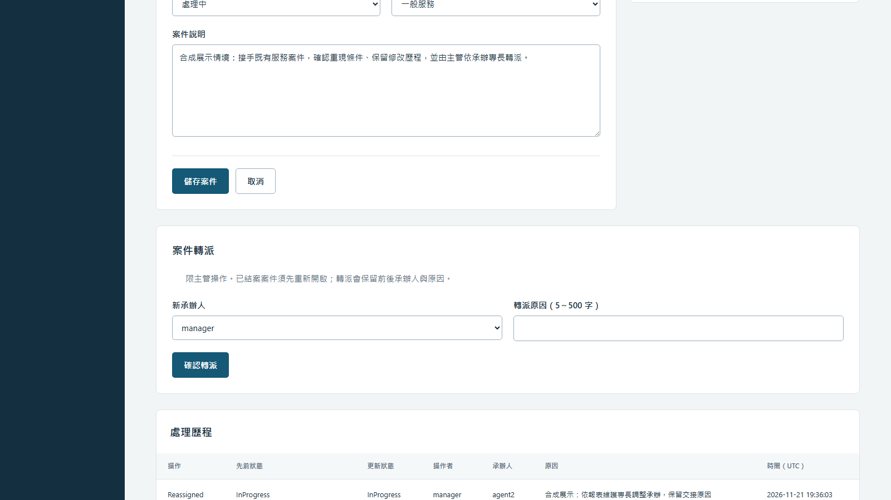
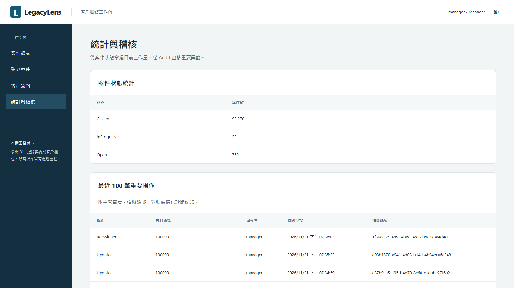
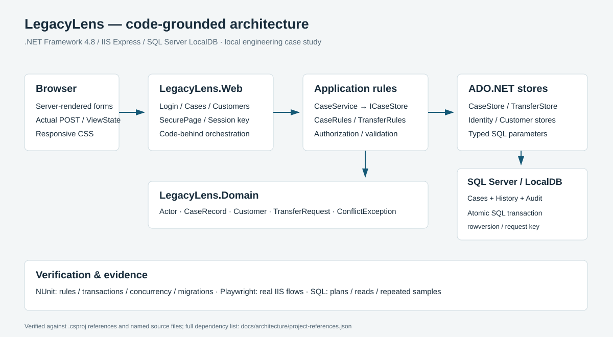
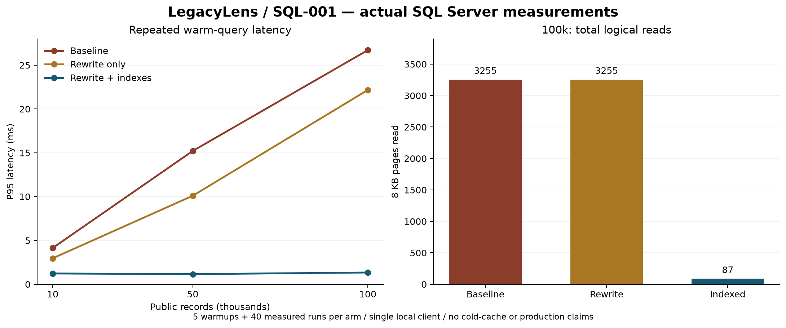

# LegacyLens

**A running ASP.NET Web Forms service-case system demonstrating legacy maintenance, debugging, SQL performance analysis and compatible change.**

[繁體中文](README.md) · [118-second actual demo](docs/media/demo.mp4) · [Engineering casebook](docs/CASEBOOK.md) · [Local development](docs/LOCAL_DEVELOPMENT.md) · [Current test evidence](docs/testing/README.md)



LegacyLens is a .NET Framework 4.8 Web Application backed by SQL Server. It examines Page Lifecycle behavior before modifying Web Forms, reproduces defects with failing tests, compares execution plans on 100,000 public records and preserves historical data when adding reassignment rules.

This is an independently initialized showcase snapshot of the reviewed application, three maintenance cases and actual media. Original development history remains in a private repository; this version starts with a new initial commit and includes no original tags or Git history. Essential evidence is available within this version. See [snapshot provenance and differences](docs/SNAPSHOT.md). No production online demo is provided.

## Actual demo



[Watch/download the MP4](docs/media/demo.mp4): 118 seconds, 1280×720, approximately 1.57 MB. [Traditional Chinese captions](docs/media/demo.zh-TW.srt) are burned in; [English subtitles](docs/media/demo.en.srt) are provided separately. The recording shows case creation, an isolated injected defect, repaired Postback behavior, measured SQL evidence, reassignment and audit. No generated mock screens or still-image imitation of interaction.

The existing recording preserves its original delivery footage and historical end-caption counts. Current verification is **58 NUnit tests and 13 Chromium E2E tests**, documented below; the video was not recreated.

## Problem and working features

An existing application can save successfully while losing drafts during a particular Postback. Small datasets can hide inefficient access paths. A new reassignment rule can be bypassed through an old write endpoint unless both paths are addressed.

| Area | Implemented behavior |
|---|---|
| Identity | Forms Authentication, session-bound ViewState, PBKDF2-SHA256, temporary login lockout and server-side Manager/Agent/Viewer checks |
| Customers | Create/edit, name search and industry filter, rowversion concurrency |
| Cases | Create, initial assignment, edit, status changes, manager reopening and history |
| Search/reporting | Title/status filters, deterministic ordering, 20-row pages, historical reads and status totals |
| Reassignment | Manager-only operation, eligible active target, reason, rowversion, request-key idempotency and preserved history |
| Audit | Atomic case/history/audit transactions, structured error events and correlation IDs |

<table><tr><td></td><td></td></tr><tr><td>SQL-backed editing with preserved drafts and history.</td><td>Manager authorization and optimistic concurrency.</td></tr><tr><td></td><td></td></tr><tr><td>Explicit transfer reason and new assignee.</td><td>Important operations linked by correlation ID.</td></tr></table>

## Three maintenance cases

| Case/classification | Investigation, decision and evidence | Traceability |
|---|---|---|
| **WEB-001 — Controlled Fault Injection** | Unconditional Page_Load binding overwrites drafts after a real POST. Compare initial-only binding, Init rebuilding and Request.Form recovery; retain `!IsPostBack`. Identical browser assertion: 1 failed → 1 passed, preserving title and description. | [RCA](docs/incidents/WEB-001.md), [ADR 0002](docs/decisions/0002-postback-binding.md) |
| **SQL-001 — Public Dataset Observation and local experiment** | Compare optional-OR SQL, rewritten predicates and covering indexes at 10k/50k/100k. Save actual plans, reads, 40 timing samples and ordered-ID equivalence at three offsets. | [Case](docs/incidents/SQL-001.md), [results](docs/benchmarks/RESULTS.md), [ADR 0003](docs/decisions/0003-search-plan.md) |
| **CHANGE-001 — Synthetic Scenario** | Add audited reassignment without an old edit-path bypass. Additive migration, legacy backfill, idempotency, concurrency and non-destructive feature rollback; test failure recovery, reruns, permissions and duplicates. | [Case](docs/incidents/CHANGE-001.md), [ADR 0004](docs/decisions/0004-reassignment-compatibility.md) |

Authentic development issues are recorded separately: [encoding and IDENTITY rollback](docs/incidents/DEV-001-bootstrap.md), [CSP/AutoPostBack incompatibility and an initial test blind spot](docs/incidents/DEV-002-postback-csp.md). Defects are injected only into isolated local copies, never through a shipped vulnerability switch. The original private repository retains `legacy-baseline-v1.1` and its packaging correction history. This snapshot does not include those tags; [baseline records](docs/testing/BASELINE.md) remain available and WEB-001 can be reproduced with the included isolated harness.

## Architecture and decisions



Four functional assemblies: Web orchestrates controls and pages; Application owns case and transfer rules; Infrastructure implements ADO.NET transactions; Domain contains models and conflicts. Application depends on neither System.Web nor database libraries. The diagram is checked against project references/source and graphify extraction; ASPX coverage limitations are explicit in [architecture documentation](docs/architecture/README.md).

Typed SQL parameters, fixed predicate fragments, server authorization, transaction-time validation, rowversion and request-key idempotency protect the write paths. ViewState MAC/encryption and EventValidation remain enabled. An external script submits the native form without unsafe-eval. [ADR 0001](docs/decisions/0001-webforms-and-local-sql.md) explains the Framework/ADO.NET/LocalDB trade-offs; the other ADRs link to actual experiments and regression evidence.

## Executed tests and measurements

| Check | Actual outcome |
|---|---|
| MSBuild Release | Passed locally and on Windows Runner; WarningLevel 4/TreatWarningsAsErrors |
| NUnit | **58/58 passed**: 25 unit and 33 real SQL integration/regression; 0 skipped; [current local report](docs/testing/showcase-nunit.xml) |
| Playwright | **13/13 Chromium E2E passed**: the original 11 plus dedicated disabled/demoted historical-assignee regressions; [current report](docs/testing/showcase-e2e.json) |
| Tool tests | **6/6 passed**: 3 report-redaction and 3 public-privacy checks |
| Dependency audit | `npm audit --audit-level=high`:0 reported vulnerabilities at execution |
| Windows CI | [Current main/PR checks](https://github.com/Cizing24/LegacyLens-Showcase/actions/workflows/windows.yml), including actual LocalDB and IIS Express E2E; [executed CI record](docs/testing/CI.md) |



100,000 public records, `Status='Open'`, identical ordering/projection and 21 returned rows. One local client, warm cache, 5 warmups and 40 measured runs per arm:

| Arm | P50 ms | P95 ms | Total logical reads |
|---|---:|---:|---:|
| Baseline |22.3420|26.7085|3,255|
| Rewrite only |16.8213|22.1663|3,255|
| Rewrite+covering indexes |1.0832|1.3413|87|

Ordered IDs match at offsets 0/20/200. [Full report](docs/benchmarks/RESULTS.md) includes every sample, actual plan,IO output, environment and index cost. Indexes consume storage and add write maintenance. Cold cache, index-write overhead, sustained concurrent load and production SLAs were not measured; these are not business-ROI claims.

## Public dataset and provenance

[Official NYC 311 data](https://data.cityofnewyork.us/Social-Services/311-Service-Requests-from-2020-to-Present/erm2-nwe9), retrieved November 22, 2026 in Taiwan time: 100,000 records and 100,000 unique keys. Only key/created date/problem category/status/agency were requested. No addresses, coordinates, contacts or free-text resolutions.

311 represents public-service requests, not B2B support. Customer and assignee fields are synthetic. The metadata licenseId is null; [provenance](docs/datasets/PROVENANCE.md) cites the official reuse policy/terms rather than inventing a CC0/MIT license. The manifest retains URLs, update time, dictionary and SHA-256. Large raw snapshots stay outside Git. A later download may differ because the upstream dataset can change.

## Stack and getting started

ASP.NET Web Forms, C#, .NET Framework 4.8, SQL Server 2019 LocalDB, ADO.NET, MSBuild, IIS Express, NUnit/NUnitLite 3.14, Playwright 1.58.2, Windows Actions, Python/matplotlib and FFmpeg. No large frontend framework, microservices or message broker.

On Windows with the prerequisites in [Local Development](docs/LOCAL_DEVELOPMENT.md):

```powershell
./tools/restore.ps1
./tools/build.ps1
powershell.exe -NoProfile -File tools/database/setup.ps1
powershell.exe -NoProfile -File tools/database/seed.ps1
powershell.exe -NoProfile -File tools/database/migrate.ps1
./tools/start.ps1
```

Open `http://localhost:5188/Login.aspx`; generated demo credentials remain in ignored `.runtime/credentials-LegacyLens.json`. See [test commands](docs/testing/README.md), [benchmark reproduction](docs/benchmarks/REPRODUCE.md), [troubleshooting](docs/TROUBLESHOOTING.md) and [rollback runbook](docs/DEPLOYMENT_ROLLBACK.md).

## Status and limitations

This standalone `main` includes the reviewed application, cases and media. Original PRs, issues, commits and baseline tags remain private and are not imported into this repository. See the [delivery report](docs/DELIVERY_REPORT.md) and the [public-readiness review](docs/security/PUBLIC_READINESS.md). This review covers the independent snapshot; the private source history is unchanged.

Real phones, Safari/Firefox, screen readers, production IIS, cold-cache measurements, sustained concurrent load and a full penetration test remain unverified. Rollback is a data-preserving feature rollback, not an assurance that arbitrary old binaries are safe writers. [Known limitations](docs/KNOWN_LIMITATIONS.md) and [security review](docs/testing/REVIEW.md) distinguish these boundaries. No vendor partnership, product certification or real enterprise adoption is claimed.
