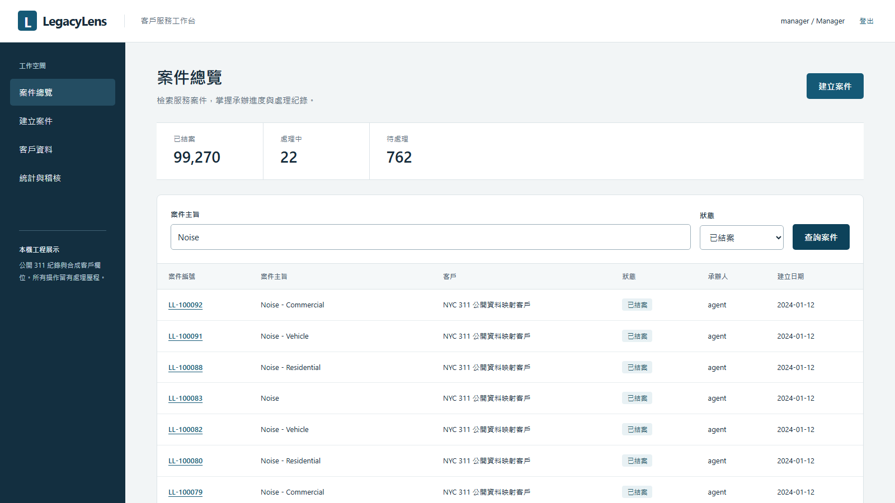
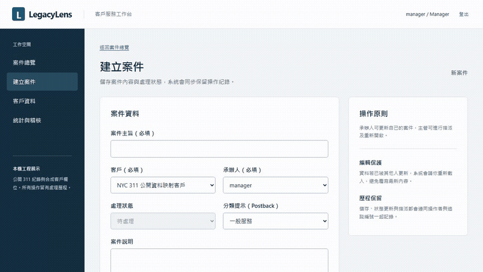
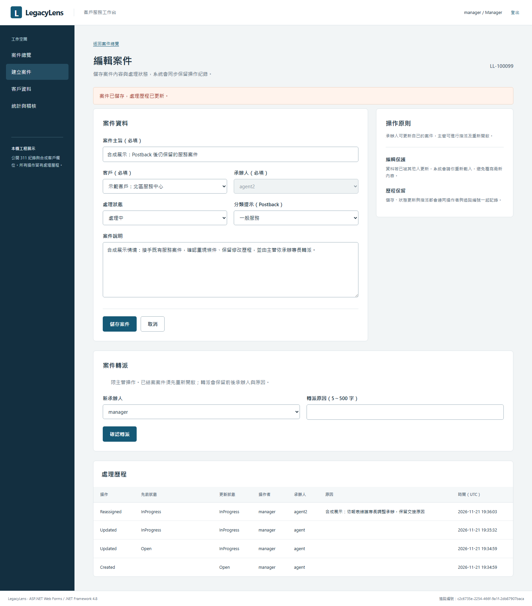
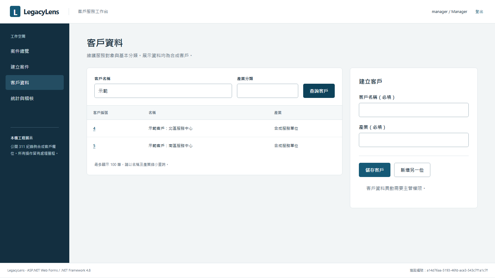
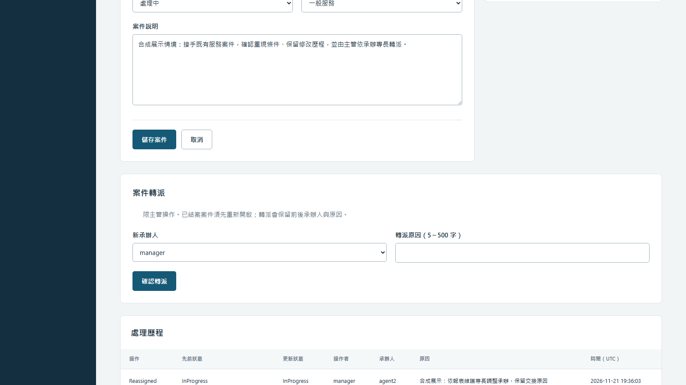
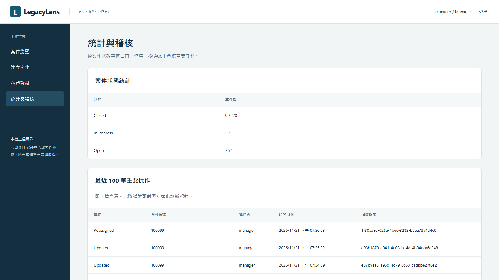
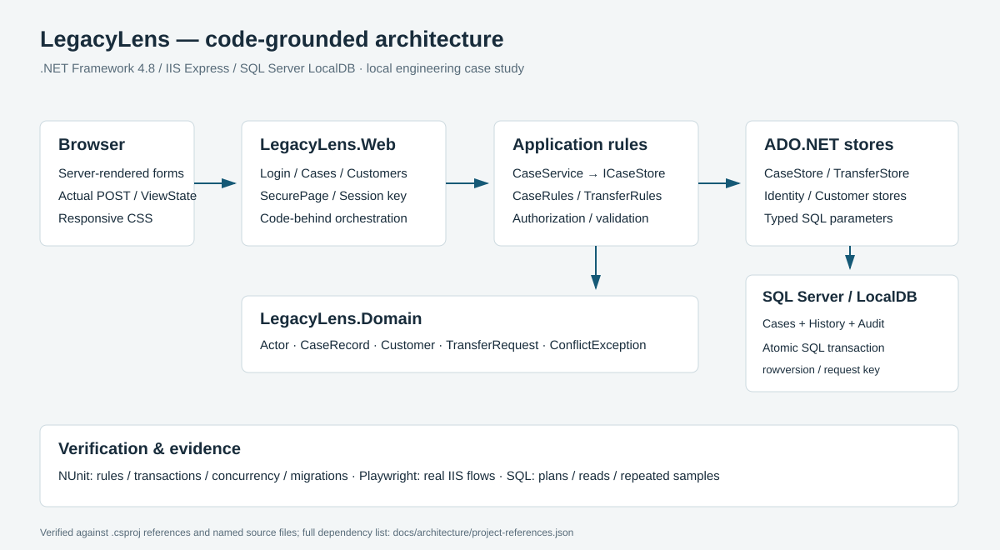
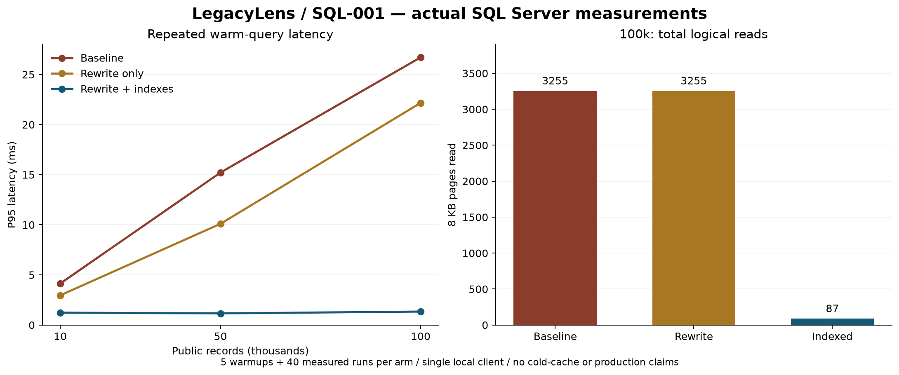

# LegacyLens

**以 ASP.NET Web Forms 客戶服務案件系統，展示既有系統維護、故障調查、SQL 效能分析與相容性變更。**

[English](README.en.md) · [118 秒實際操作影片](docs/media/demo.mp4) · [工程案例](docs/CASEBOOK.md) · [本機啟動](docs/LOCAL_DEVELOPMENT.md) · [最新測試證據](docs/testing/README.md)



這是一套真正連接 SQL Server 的 .NET Framework 4.8 Web Application。工程重點是：修改 Web Forms 前確認 Page Lifecycle、用失敗測試重現問題、在 100,000 筆公開資料上比較查詢計畫，以及在新增轉派規則時保留舊資料與歷史。

這是經審查的獨立展示快照，保留完整功能、三個維護案例與實際展示素材。原始開發歷程保存在私人 Repository；本版從全新 Initial Commit 開始，未匯入原有 Tags 或 Git History。必要證據均可由本版文件查閱，詳見 [快照來源與差異](docs/SNAPSHOT.md)。目前未提供正式線上 Demo。

## 操作展示



[觀看／下載 MP4](docs/media/demo.mp4)（118 秒，1280×720，約 1.57 MB）· [繁體中文字幕](docs/media/demo.zh-TW.srt) · [English subtitles](docs/media/demo.en.srt)。影片依序展示案件建立、隔離的故障注入、修復後 Postback、SQL 實測報告、轉派與 Audit；所有畫面出自實際瀏覽器執行，沒有 AI 假 Dashboard 或靜態圖片合成互動。

影片保留初始交付當時的畫面與片尾測試數；最新 **58 個 NUnit／13 個 E2E** 結果以本頁與測試證據為準，未重製既有影片。

## 系統解決的問題

維護既有案件系統時，畫面可以正常儲存，仍可能在特定 Postback 丟失草稿；少量資料能順利查詢，也不代表資料成長後仍有合適的存取路徑。新增轉派規則時，還必須封住舊的寫入入口，並保留當時沒有理由欄位的歷史紀錄。

LegacyLens 以三個具體案例處理這些問題。受控缺陷只存在於獨立本機複本；真正開發時遇到的編碼、CSP、Migration 與 CI 問題另行記錄，沒有包裝成企業事故。

## 可操作功能

| 範圍 | 已實作內容 |
|---|---|
| 登入與權限 | Forms Authentication、Session 綁定 ViewState、PBKDF2-SHA256、登入失敗鎖定；Manager / Agent / Viewer 後端檢查 |
| 客戶 | 建立、編輯、名稱搜尋與產業篩選；修改使用 rowversion |
| 案件 | 建立、初次指派、編輯、狀態更新、主管重新開啟、處理歷程 |
| 搜尋與統計 | 主旨／狀態條件、穩定排序、20 筆分頁、狀態統計、歷史案件讀取 |
| 轉派 | 主管限定、有效承辦人、原因、版本檢查、Request ID 防重送、前後承辦與歷程 |
| 稽核與診斷 | 同一 transaction 保存案件／History／Audit；Correlation ID 與結構化錯誤紀錄 |

<table><tr><td></td><td></td></tr><tr><td>案件表單保留 Postback 編輯狀態，更新附帶歷程。</td><td>客戶資料具有後端主管權限與版本保護。</td></tr><tr><td></td><td></td></tr><tr><td>轉派需要理由，並記錄新承辦人及操作。</td><td>依操作者與追蹤編號查核最近的重要異動。</td></tr></table>

## 三個維護案例

| 案例與分類 | 問題、決策與驗證 | 追溯 |
|---|---|---|
| **WEB-001** · Controlled Fault Injection | 無條件 Page_Load binding 在真正 POST 後覆寫草稿。比較初次 binding、Init 重建與 Request.Form 補救；採 `!IsPostBack`。相同測試由 1 failed → 1 passed，保留主旨與說明。 | [RCA](docs/incidents/WEB-001.md) · [ADR 0002](docs/decisions/0002-postback-binding.md) |
| **SQL-001** · Public Dataset Observation＋本機實驗 | 以 10k／50k／100k 官方 311 紀錄比較 optional-OR、query rewrite 與 covering index。保存 actual plans、Logical Reads、40 次 samples 與三個分頁位置的結果等價。 | [Case](docs/incidents/SQL-001.md) · [實測報告](docs/benchmarks/RESULTS.md) · [ADR 0003](docs/decisions/0003-search-plan.md) |
| **CHANGE-001** · Synthetic Scenario | 新轉派規則阻擋舊編輯入口繞過。Additive Migration、舊資料 Backfill、idempotency、rowversion 與不刪資料的 feature rollback；實測失敗回復、重跑、權限與併發。 | [Case](docs/incidents/CHANGE-001.md) · [ADR 0004](docs/decisions/0004-reassignment-compatibility.md) |

真實開發問題：[Seed 編碼與 IDENTITY rollback](docs/incidents/DEV-001-bootstrap.md)、[CSP 阻擋原生 AutoPostBack 與測試盲點](docs/incidents/DEV-002-postback-csp.md)。原私人版本以 `legacy-baseline-v1.1` 保存 Baseline，`v1` 的 Schema staging 遺漏以後續 Commit 修正。本版不含這些歷史 Tags；保留 [Baseline 驗證紀錄](docs/testing/BASELINE.md)，WEB-001 可用本版隔離工具重現。

## 架構與工程重點



四個具實際責任的 assembly：Web 處理控制項與頁面流程，Application 放案件／轉派規則，Infrastructure 使用 ADO.NET 與 transaction，Domain 保存模型與衝突型別。Application 不依賴 System.Web 或資料庫。圖表根據 `.csproj`、實際 source 與 graphify 結構結果製作；[架構與限制](docs/architecture/README.md) 說明工具未涵蓋的 ASPX 部分。

- SQL 採明確型別參數；可組合條件只使用固定 SQL 片段。
- 權限與規則在後端檢查；transaction 內再次查驗目前資料。
- rowversion 防止過期編輯覆寫；轉派 Request ID 確保同一要求重送不增加歷程。
- 保留 ViewState MAC、加密與 EventValidation；分類以外部 JavaScript 送出真正表單，不開 unsafe-eval。
- [ADR 0001](docs/decisions/0001-webforms-and-local-sql.md) 記錄 Framework／ADO.NET／LocalDB 選擇與代價；其他 ADR 連結到實測與回歸。

## 測試與量化結果

| 驗證 | 實際結果 |
|---|---|
| MSBuild Release | 本機與 GitHub Windows Runner 成功；WarningLevel 4、TreatWarningsAsErrors |
| NUnit | **58／58 通過**：25 Unit＋33 真正 SQL integration／regression，0 skipped；[目前本機原始結果](docs/testing/showcase-nunit.xml) |
| Playwright | **13／13 Chromium E2E 通過**：既有11項加上承辦人停用／降為 Viewer 的兩項專屬回歸；[目前原始結果](docs/testing/showcase-e2e.json) |
| 工具測試 | **6／6 通過**：3 項報告清理＋3 項公開掃描測試 |
| 依賴檢查 | `npm audit --audit-level=high` 當次回報0 vulnerabilities |
| Windows CI | [最新 main／PR Checks](https://github.com/Cizing24/LegacyLens-Showcase/actions/workflows/windows.yml)，包含真實 DB 與 IIS Express E2E；[實際執行紀錄](docs/testing/CI.md) |



100,000 筆公開紀錄、`Status='Open'`、同一排序與21筆回傳，單一本機 client、warm cache；每方案5次預熱、40次計時：

| 方案 | P50 ms | P95 ms | 全查詢 Logical Reads |
|---|---:|---:|---:|
| Baseline | 22.3420 | 26.7085 | 3,255 |
| 僅 query rewrite | 16.8213 | 22.1663 | 3,255 |
| Rewrite＋covering indexes | 1.0832 | 1.3413 | 87 |

同時檢查 offsets 0／20／200 的有序 ID 相同。所有原始 samples、plans、IO 與環境在 [Benchmark Report](docs/benchmarks/RESULTS.md)。索引有空間與寫入維護代價；沒有測 cold cache、長時間多使用者壓力或索引寫入 overhead，這些數字不代表 production SLA 或企業導入效益。

## 公開資料與來源

使用 [NYC 311 官方資料](https://data.cityofnewyork.us/Social-Services/311-Service-Requests-from-2020-to-Present/erm2-nwe9)，取得於2026-11-22（台灣時間）。100,000 筆、100,000 個唯一鍵，只下載 key、建立日期、問題分類、狀態、機關五欄；地址、座標、聯絡資料與自由文字沒有要求下載。

311 為公共服務請求；客戶與承辦是明確的合成映射，不宣稱是B2B企業資料。Metadata 的 licenseId 為 null，使用依據及官方政策見 [Provenance](docs/datasets/PROVENANCE.md)，沒有誤標為CC0／MIT。manifest 保留查詢URL、更新時間、字典與SHA-256；大型原快照不提交。

## Tech Stack

ASP.NET Web Forms · C# · .NET Framework 4.8 · SQL Server 2019 LocalDB · ADO.NET · MSBuild · IIS Express · NUnit / NUnitLite 3.14 · Playwright 1.58.2 · GitHub Actions Windows · Python / matplotlib · FFmpeg。

沒有大型前端框架、Microservices、Kubernetes 或額外訊息系統。

## Getting Started

依 [Local Development Guide](docs/LOCAL_DEVELOPMENT.md) 安裝 Windows 開發元件後：

```powershell
./tools/restore.ps1
./tools/build.ps1
powershell.exe -NoProfile -File tools/database/setup.ps1
powershell.exe -NoProfile -File tools/database/seed.ps1
powershell.exe -NoProfile -File tools/database/migrate.ps1
./tools/start.ps1
```

本機開啟 `http://localhost:5188/Login.aspx`；展示密碼在 ignored `.runtime/credentials-LegacyLens.json`。其他工程師可依 [測試說明](docs/testing/README.md)、[Benchmark 重現](docs/benchmarks/REPRODUCE.md)、[Troubleshooting](docs/TROUBLESHOOTING.md) 與 [Rollback Runbook](docs/DEPLOYMENT_ROLLBACK.md) 操作。

## 專案狀態與限制

本版 `main` 保留三個工程案例與主要成果；來源 PR、Issue、Commit 屬私人開發歷程，不是本版可瀏覽的歷史。完整驗收與媒體清單見 [Delivery Report](docs/DELIVERY_REPORT.md)，公開前風險見 [Public Readiness](docs/security/PUBLIC_READINESS.md)。

仍未驗證真實手機、Safari／Firefox、螢幕閱讀器、正式IIS部署、cold cache、多使用者長壓力與完整滲透測試。回復為保留schema/history的feature rollback，不保證任意舊binary可安全寫入。詳細範圍見 [Known Limitations](docs/KNOWN_LIMITATIONS.md) 與 [Security Review](docs/testing/REVIEW.md)。本作品不宣稱與任何特定企業軟體廠商存在合作、認證或實際導入。
