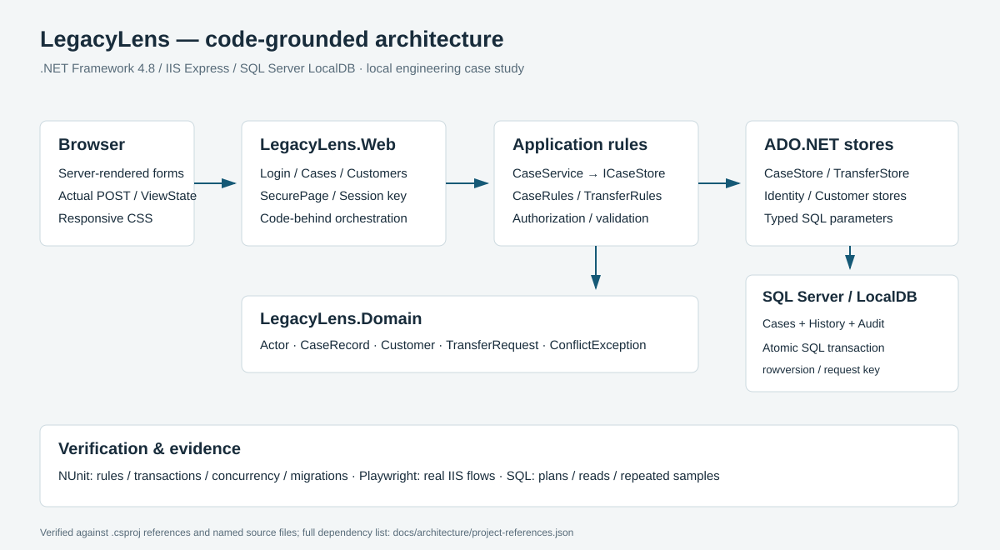
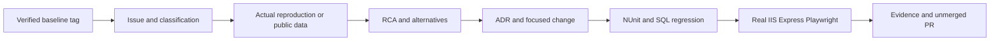

# 實際架構與資料流

圖表根據實際 `.csproj` ProjectReference 與五個具名核心 source assertions 產生，精確 assembly 關係見 [project-references.json](project-references.json)。graphify 對 src 結構擷取產生 174 nodes / 417 edges；ASP.NET markup 等九個檔案不支援，因此頁面與資料庫部分另以實際 source/SQL 查驗，未宣稱 graphify 解析了所有 Web Forms 元件。

Web Forms 的 Code-behind 負責控制項、Postback、呈現與呼叫應用邏輯；SecurePage 每次 request 根據 authenticated username 重新讀取 active Actor，再綁定 session CSRF key。CaseService 透過 ICaseStore 儲存；CaseRules / TransferRules 為可測規則，ADO.NET store 在 transaction 內再次驗證最新資料。Infrastructure 依賴 Application 的介面與規則，以及 Domain 模型；Application 不依賴 System.Web 或 SQL Server 套件。

SQL 的 Cases、Customers、Users 具 FK/rowversion，CaseHistory 與 AuditLog 同步記錄狀態變動。TransferOperations 的 request key 是 idempotency 契約，FeatureFlags 只為安全暫停新轉派，沒有關閉驗證或啟用漏洞的 app switch。

這是本機企業系統維護案例作品，不是多租戶 SaaS；沒有與特定企業產品合作、相容認證或正式導入的主張。
